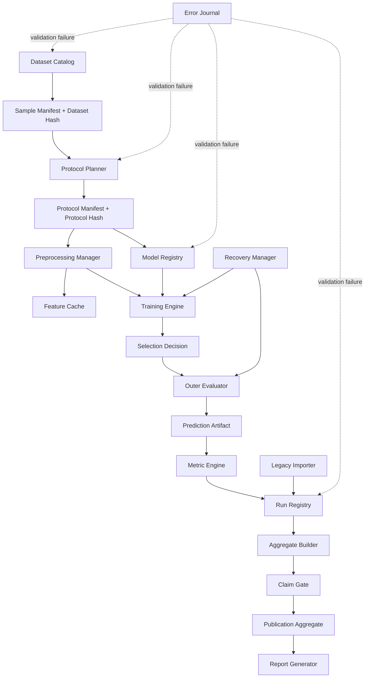
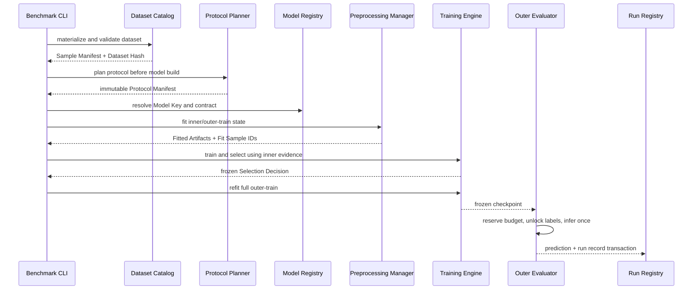
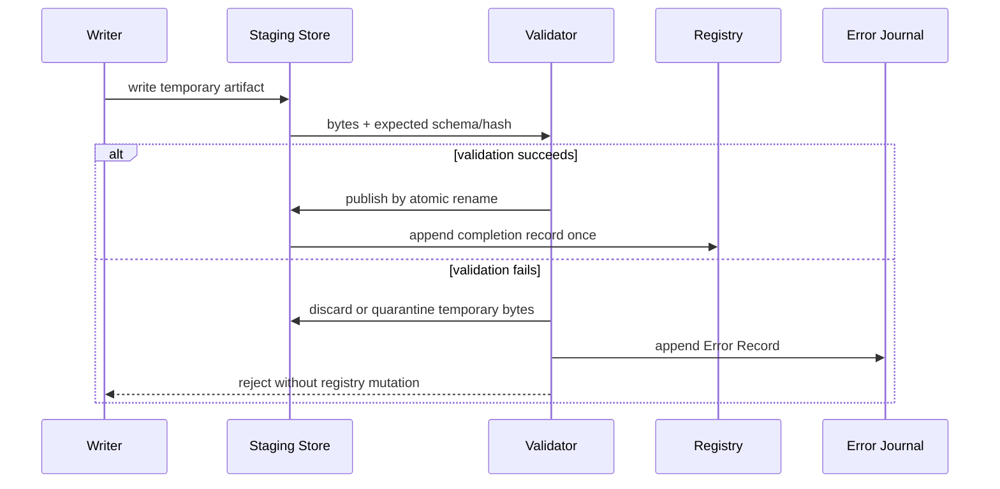
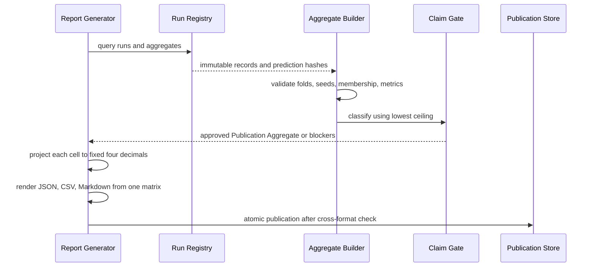

# Design Document: CVPR 2027 Hyperspectral Benchmark

## Overview

本设计把 HyperCross 的分散实验脚本迁移为协议优先、prediction-first、append-only 的统一 benchmark。系统在模型构建前冻结数据与协议身份，将所有学习型预处理和选择限制在许可训练边界内，并从逐样本预测生成指标、统计量、表格和 claim 状态。

benchmark 保留三个独立轨道：HyperLeaf2024 三目标回归、HistologyHSI-GB 患者级二分类和 Remote_Sensing_Sanity_Track。跨轨道结果不得汇总为单一总分；不同 `Protocol_Hash` 的结果不得生成 paired rank 或 improvement。现有结果作为 `Legacy_Evidence` 导入，不修改源文件、checkpoint 或历史数值。

本规范保留 High-Level Design 与 Structured Pseudocode Low-Level Design。当前工作只更新设计，不修改实现代码、不运行训练或评测，也不重建 `.config.kiro`。

## Current Repository Assessment

- `src/hypercross_routeA.py` 包含 HyperLeaf、Histology 数据读取、Global/Token/Local Route A、MIL 控制、训练和评估逻辑。
- `src/modern_hsi_models.py` 中的 `HybridSN_lite`、`S2Mamba_lite`、`MamTrans_lite` 是 proxy，不是官方上游实现。
- 历史 patient CV 在 outer fold 上选择 epoch，其 `0.9153 ± 0.0686` 只能标为 `development`。
- 历史固定 9/4 patient split 和 `0.9392` ensemble 只能标为 `exploratory`。
- Indian Pines S²Mamba 的 `0.9749/0.9871/0.9712` 只属于 `sanity_only`。
- Global Route A 在每个模态仅产生一个 token，不能把其效果归因于可学习的单 token correspondence。
- 现有 JSON、CSV、Markdown 结果主要由人工同步，缺少统一 manifest、prediction artifact、环境锁和 claim gate。

## Design Goals and Non-Goals

### Goals

- 冻结数据、协议、候选空间、选择规则、种子和资源预算后再执行模型。
- 对 sample、group、fold、transform、model、prediction、run、aggregate 和 publication 建立可验证 lineage。
- 以 `Failure_Atomicity` 保护已有 registry、manifest、artifact 和 completed run。
- 支持中断恢复、缺失作业重排和重复完成记录审计。
- 从一个权威 registry 同步生成四位小数 JSON、CSV、Markdown 和 audit 输出。
- 用明确的 `Claim_Status_Ceiling` 限制 legacy、proxy、sanity、development 和 strict evidence。

### Non-Goals

- 不修改现有训练实现或运行实验。
- 不把 remote sensing 结果外推到植物或病理任务。
- 不把 proxy 命名为 official implementation。
- 不覆盖历史结果、checkpoint、manifest 或已完成 artifact。
- 不允许分数提升绕过 protocol、provenance、seed、fold、control 或 reproduction gate。

# High-Level Design

## Architecture



### Architectural Decisions

1. **Protocol before model**：`Sample_Manifest` 和 `Protocol_Manifest` 必须完成验证并发布，`Model_Registry` 才能构建模型。
2. **Canonical identity**：hash-bearing 记录只使用 `Canonical_Serialization`。输入枚举顺序不影响 `Dataset_Hash` 或 `Protocol_Hash`。
3. **Outer labels are capability-gated**：selector、transform fitter 和 trainer 没有 outer-label capability；只有冻结 checkpoint 的 evaluator 可以在预算许可后读取。
4. **Fitted state is fold-scoped**：PCA、target normalization、band normalization、imputation、class weight、threshold 和 calibration 都保存精确 `Fit_Sample_IDs`。
5. **Predictions are authoritative**：正式指标只从完整且唯一的 `Prediction_Artifact` 计算。
6. **Append-only evidence**：`Run_Record`、`Aggregate_Record`、supersession 和错误记录只追加。任何修正都创建新记录。
7. **Transactional publication**：所有 artifact 先写临时文件、校验 hash，再原子发布；失败不改变既有完成状态。
8. **Claim and score separation**：Claim Gate 使用全部适用 ceiling 的最低允许状态，分数本身不能提高状态。
9. **Publication is a gated projection**：只有 fold、Seed_Set、prediction、provenance 和 claim 检查完整的 aggregate 才能生成 `Publication_Aggregate`。

## Canonical Serialization and Hashing

`Canonical_Serialization` 是所有 manifest、配置、lineage 和 artifact identity 的唯一 hash 输入，规则如下：

- 文本统一为 Unicode NFC，并使用 UTF-8，无 BOM。
- object 字段按字段名 UTF-8 字节序排序；未声明字段被 schema 拒绝。
- set 先按元素自身 canonical bytes 排序再编码；有语义顺序的 sequence 保留顺序。
- `Sample_ID` 和 `Group_ID` 在排序前执行 NFC 与路径分隔符规范化；禁止大小写折叠。
- integer 使用无前导零十进制；有限 binary64 使用带类型标签的 IEEE-754 hexadecimal 字符串；拒绝 NaN 和 Infinity。
- boolean、null、timestamp 和 enum 分别使用固定 token；timestamp 使用 UTC RFC 3339 微秒格式。
- map、set、sequence 和 scalar 使用无空白、长度有界的 canonical JSON 表达。
- publication 的四位小数格式不参与科学 artifact hash；raw metric 和 publication projection 分开保存。

```pascal
INTERFACE CanonicalCodec
  FUNCTION Serialize(value: SchemaBoundValue): Bytes
  FUNCTION Hash(value: SchemaBoundValue): ContentHash
  FUNCTION NormalizeId(value: String): String
END INTERFACE
```

## Main Sequences

### Protocol-first strict execution



### Failure-atomic artifact publication



### Resume and missing-job recovery

```mermaid
sequenceDiagram
    participant C as CLI
    participant X as Recovery Manager
    participant R as Run Registry
    participant A as Artifact Store
    participant E as Training Engine

    C->>X: resume(run_id, request)
    X->>R: load Frozen Run Identity
    X->>X: compare dataset/protocol/model/config/fold/seed/environment
    alt compatible
      X->>A: load last complete recovery artifact
      A-->>E: model + optimizer + scheduler + stage state
    else incompatible
      X->>R: append failure reason to Error Journal
      X-->>C: reject in-place resume; require new Run ID
    end
    C->>X: schedule missing aggregate members
    X->>R: query declared minus canonical completed jobs
    X-->>C: exact missing job set
```

### Authoritative report generation



## Components and Interfaces

### Dataset Catalog

```pascal
INTERFACE DatasetCatalog
  FUNCTION MaterializeManifest(spec: DatasetSpec): Result[SampleManifest, ErrorRecord]
  FUNCTION ValidateManifest(manifest: SampleManifest): ValidationReport
  FUNCTION ExportDeidentified(manifest: SampleManifest): PublicSampleManifest
END INTERFACE
```

职责：为全部 materialized samples 分配唯一 `Sample_ID`；grouped task 要求非空 `Group_ID`；保存全部输入 hash 和 label schema；验证精确样本数、可读性和标签维度；Histology 发布时使用稳定脱敏 group mapping。

### Protocol Planner

```pascal
INTERFACE ProtocolPlanner
  FUNCTION Plan(manifest: SampleManifest, spec: ProtocolSpec): Result[ProtocolManifest, ErrorRecord]
  FUNCTION ValidateCoverage(plan: ProtocolManifest): ValidationReport
  FUNCTION ValidateIsolation(plan: ProtocolManifest): ValidationReport
  FUNCTION Reload(bytes: Bytes): ProtocolManifest
END INTERFACE
```

职责：在模型构建前持久化 protocol；记录 canonical sample sets；保证 outer disjointness、group isolation、exact coverage 和 inner containment；保存 selection policy 与 evaluation budget。

### Preprocessing Manager and Feature Cache

```pascal
INTERFACE PreprocessingManager
  FUNCTION Fit(kind, fit_ids, allowed_ids, config): Result[FittedArtifact, ErrorRecord]
  FUNCTION Apply(artifact: FittedArtifact, samples): Result[TensorBundle, ErrorRecord]
  FUNCTION ValidateBoundary(artifact, fold): ValidationReport
END INTERFACE

INTERFACE FeatureCache
  FUNCTION Get(key: FeatureCacheKey, expected: FeatureLineage): Result[TensorBundle, ErrorRecord]
  PROCEDURE PutAtomic(key, value, lineage)
END INTERFACE
```

职责：记录所有 learned state 的精确 fit IDs；outer evaluation 要求 `Fit_Sample_IDs ⊆ Outer_Train_Set`；inner candidate 要求 fit IDs 位于 inner train；cache key 包含 dataset、protocol、fold、representation 和 transform-state hash；任何 source、transform、fit boundary 或 shape 不匹配都在返回数据前拒绝。

### Model Registry and Reproduction Gate

```pascal
INTERFACE ModelRegistry
  FUNCTION Resolve(model_key: String): Result[ModelRegistration, ErrorRecord]
  FUNCTION Build(registration, seed, output_spec): Result[TrainableModel, ErrorRecord]
  FUNCTION ValidateInstance(registration, instance, supplied_contract): ValidationReport
END INTERFACE

INTERFACE ReproductionGate
  FUNCTION ApproveAdaptation(model: ModelRegistration, upstream_record): GateDecision
END INTERFACE
```

职责：一个 key 只解析到一个 identity 和一个 input contract；检查类全限定名、implementation category、modalities、shape、dtype、channel/band order 和 preprocessing key；官方模型保存 URL、commit、license、source hash、patch hash 和 reproduction status；proxy display name 强制包含 `proxy`。

### Training Engine and Selection Controller

```pascal
INTERFACE TrainingEngine
  FUNCTION TrainInner(request: InnerTrainRequest): TrainingArtifact
  FUNCTION FreezeSelection(scores, policy): SelectionDecision
  FUNCTION RefitOuterTrain(request, decision): CheckpointArtifact
  FUNCTION Resume(request, recovery: RecoveryArtifact): TrainingArtifact
END INTERFACE

INTERFACE OuterEvaluationGate
  FUNCTION Reserve(protocol_key, requested_count): EvaluationLease
  FUNCTION Evaluate(lease, checkpoint, fitted_artifacts, outer_ids): PredictionArtifact
  PROCEDURE CommitSuccessfulEvaluation(lease)
END INTERFACE
```

职责：候选空间、分数、source sample IDs、metric direction、tie-break 和 prediction hash 全部进入 `Selection_Decision`；decision 在 outer labels 可访问前冻结；outer evaluation 禁用 gradient 和 fitted-state update；只有成功评估才将 budget consumed count 增加一次。

### Metric Engine and Aggregate Builder

```pascal
INTERFACE MetricEngine
  FUNCTION ValidatePredictions(artifact, expected_ids): ValidationReport
  FUNCTION RegressionMetrics(artifact, schema): MetricSet
  FUNCTION BinaryMetrics(artifact, threshold, schema): MetricSet
  FUNCTION RemoteMetrics(artifact, schema): MetricSet
  FUNCTION PatientBootstrap(artifact, metric, seed): ConfidenceInterval
  FUNCTION PairedPatientCompare(candidate, control, metric, seed): StatisticalComparison
END INTERFACE

INTERFACE AggregateBuilder
  FUNCTION Build(member_run_ids, aggregation_policy): Result[AggregateRecord, ErrorRecord]
  FUNCTION Promote(record: AggregateRecord): Result[PublicationAggregate, ErrorRecord]
END INTERFACE
```

职责：正式指标只接受已验证 prediction；区分 fold-macro、pooled OOF、seed variance 和 fold variance；undefined AUROC/R² 返回 null 与固定 reason；Histology CI 和 paired comparison 以 patient 为重采样单位，固定 10,000 次、双侧 95%。

### Run Registry, Claim Gate, Recovery Manager

```pascal
INTERFACE RunRegistry
  FUNCTION AllocateRun(identity: FrozenRunIdentity): RunId
  PROCEDURE Append(record: RunRecord)
  PROCEDURE AppendAggregate(record: AggregateRecord)
  PROCEDURE Supersede(old_id, new_id, reason)
  FUNCTION CanonicalCompleted(job_key): OPTIONAL RunRecord
END INTERFACE

INTERFACE ClaimGate
  FUNCTION ApplicableCeilings(evidence): Sequence[ClaimCeiling]
  FUNCTION Classify(evidence): ClaimDecision
END INTERFACE

INTERFACE RecoveryManager
  FUNCTION Resume(run_id, request): Result[RecoveryArtifact, ErrorRecord]
  FUNCTION MissingJobs(aggregate_spec): Set[JobKey]
  FUNCTION PublishAtomic(staged: StagedArtifact): Result[ArtifactRef, ErrorRecord]
END INTERFACE
```

`Canonical_Completed_Record` 选择规则固定为：identity 完全匹配的 `COMPLETE` records 中，先按 `completed_utc`，再按 `Run_ID` canonical bytes 取最小项。其他 duplicate records 保留审计但不聚合。

### Report Generator and Error Journal

```pascal
INTERFACE ReportGenerator
  FUNCTION BuildMatrix(publication: PublicationAggregate): PublicationMatrix
  FUNCTION RenderJson(matrix): Bytes
  FUNCTION RenderCsv(matrix): Bytes
  FUNCTION RenderMarkdown(matrix): Bytes
  FUNCTION ValidateCrossFormat(json, csv, markdown): ValidationReport
END INTERFACE

INTERFACE ErrorJournal
  PROCEDURE Append(error: ErrorRecord)
END INTERFACE
```

Error Journal 与主 Run Registry 分离，因此失败操作可以发出 `Error_Record`，同时保持失败前 registry、manifest、artifact 和 completed run 不变。

## Data Models

```pascal
STRUCTURE DatasetSpec
  dataset_key: String
  task_kind: ENUM {MULTI_TARGET_REGRESSION, BINARY_CLASSIFICATION, REMOTE_CLASSIFICATION}
  expected_sample_count: PositiveInteger
  label_schema: LabelSchema
  grouped: Boolean
  license_reference: OPTIONAL URI
END STRUCTURE

STRUCTURE SampleRecord
  sample_id: SampleId
  group_id: OPTIONAL GroupId
  label_reference: LabelReference
  input_references: Map[String, URI]
  input_content_hashes: Map[String, ContentHash]
  label_schema_metadata: Map[String, Scalar]
END STRUCTURE

STRUCTURE SampleManifest
  schema_version: String
  dataset_key: String
  records: Sequence[SampleRecord]
  canonical_order: Sequence[SampleId]
  dataset_hash: ContentHash
  created_utc: Timestamp
END STRUCTURE
```

```pascal
STRUCTURE InnerFold
  fold_id: FoldId
  train_ids: CanonicalSet[SampleId]
  validation_ids: CanonicalSet[SampleId]
END STRUCTURE

STRUCTURE OuterFold
  fold_id: FoldId
  outer_train_ids: CanonicalSet[SampleId]
  outer_test_ids: CanonicalSet[SampleId]
  inner_folds: Sequence[InnerFold]
END STRUCTURE

STRUCTURE EvaluationBudget
  maximum_successful_evaluations: PositiveInteger
  consumed_successful_evaluations: NonNegativeInteger
END STRUCTURE

STRUCTURE ProtocolManifest
  schema_version: String
  protocol_key: String
  dataset_hash: ContentHash
  folds: Sequence[OuterFold]
  selection_policy: SelectionPolicy
  seed_set: CanonicalSet[Integer]
  evaluation_budget: EvaluationBudget
  protocol_hash: ContentHash
END STRUCTURE
```

```pascal
STRUCTURE FittedArtifact
  artifact_id: ArtifactId
  kind: ENUM {TARGET_NORMALIZATION, PCA, BAND_NORMALIZATION, IMPUTATION, CLASS_WEIGHTS, THRESHOLD, CALIBRATION}
  dataset_hash: ContentHash
  protocol_hash: ContentHash
  fold_id: FoldId
  fit_sample_ids: CanonicalSet[SampleId]
  config_hash: ContentHash
  input_hash: ContentHash
  state_hash: ContentHash
  output_shape: Shape
END STRUCTURE

STRUCTURE FeatureCacheKey
  dataset_hash: ContentHash
  protocol_hash: ContentHash
  fold_id: FoldId
  representation_key: String
  transform_state_hash: ContentHash
END STRUCTURE

STRUCTURE FeatureLineage
  source_hashes: CanonicalMap[String, ContentHash]
  config_hash: ContentHash
  fit_sample_ids: CanonicalSet[SampleId]
  transform_hash: ContentHash
  output_shape: Shape
END STRUCTURE
```

```pascal
STRUCTURE ModelIdentity
  model_key: String
  display_name: String
  class_fully_qualified_name: String
  implementation_kind: ENUM {CLASSIC, IN_REPO, OFFICIAL, ADAPTED_OFFICIAL, PROXY}
  parameter_count: NonNegativeInteger
  source_revision: String
END STRUCTURE

STRUCTURE InputContract
  representation_key: String
  modalities: CanonicalSet[String]
  tensor_shapes: CanonicalMap[String, Shape]
  dtypes: CanonicalMap[String, DType]
  channel_or_band_order: CanonicalMap[String, Sequence[String]]
  preprocessing_key: String
END STRUCTURE

STRUCTURE Provenance
  code_revision: String
  upstream_repository: OPTIONAL URI
  upstream_commit: OPTIONAL String
  license_reference: OPTIONAL URI
  source_hash: ContentHash
  local_patch_hash: OPTIONAL ContentHash
  environment_hash: ContentHash
  config_hash: ContentHash
  dataset_hash: ContentHash
  artifact_hashes: CanonicalMap[ArtifactId, ContentHash]
  upstream_reproduction_status: OPTIONAL String
  adaptation_notes: Sequence[String]
END STRUCTURE
```

```pascal
STRUCTURE SelectionDecision
  decision_id: UUID
  fold_id: FoldId
  candidates: CanonicalSequence[Candidate]
  candidate_scores: CanonicalMap[CandidateId, Real]
  source_sample_ids: CanonicalSet[SampleId]
  metric_direction: ENUM {MINIMIZE, MAXIMIZE}
  tie_break_rule: String
  source_prediction_hash: ContentHash
  selected_candidate: CandidateId
  frozen_utc: Timestamp
END STRUCTURE

STRUCTURE PredictionKey
  sample_id: SampleId
  fold_id: FoldId
  seed: Integer
  inference_branch: String
END STRUCTURE

STRUCTURE PredictionRecord
  key: PredictionKey
  target_name: OPTIONAL String
  y_true: Scalar
  y_pred: Scalar
  probability: OPTIONAL Real
END STRUCTURE

STRUCTURE PredictionArtifact
  artifact_id: ArtifactId
  run_id: RunId
  records: Sequence[PredictionRecord]
  expected_sample_ids: CanonicalSet[SampleId]
  content_hash: ContentHash
  complete: Boolean
END STRUCTURE
```

```pascal
STRUCTURE EnvironmentLock
  python_version: String
  pytorch_version: String
  numpy_version: String
  pandas_version: String
  pillow_version: String
  tifffile_version: String
  sklearn_version: String
  scipy_version: String
  cuda_version: OPTIONAL String
  device_identity: String
  lock_hash: ContentHash
END STRUCTURE

STRUCTURE FrozenRunIdentity
  dataset_hash: ContentHash
  protocol_hash: ContentHash
  model_key: String
  config_hash: ContentHash
  fold_id: FoldId
  seed: Integer
  environment_lock_hash: ContentHash
  environment_compatibility_policy: String
END STRUCTURE

STRUCTURE RecoveryArtifact
  run_id: RunId
  frozen_identity: FrozenRunIdentity
  model_state_hash: ContentHash
  optimizer_state_hash: ContentHash
  scheduler_state_hash: ContentHash
  stage_state_hash: ContentHash
  last_completed_stage: String
  completed_checkpoint_boundary: Integer
END STRUCTURE
```

```pascal
STRUCTURE ResourceLimit
  field: String
  value: PositiveInteger
  unit: String
  enforcement: ENUM {HARD, ADVISORY}
END STRUCTURE

STRUCTURE ResourceBudget
  limits: NonEmptySequence[ResourceLimit]
END STRUCTURE

STRUCTURE RuntimeMeasurements
  completed_epochs: NonNegativeInteger
  completed_training_steps: NonNegativeInteger
  wall_clock_duration_ms: NonNegativeInteger
  peak_device_memory_bytes: NonNegativeInteger
  device_identity: String
  numeric_precision: String
  parameter_count: NonNegativeInteger
  input_volume_bytes: NonNegativeInteger
END STRUCTURE
```

```pascal
ENUM ClaimStatus
  primary_strict
  strict_candidate
  development
  exploratory
  sanity_only
  proxy_only
  invalid_or_leaky
END ENUM

STRUCTURE ClaimCeiling
  status: ClaimStatus
  reason_code: String
  evidence_reference: String
END STRUCTURE

STRUCTURE ClaimDecision
  status: ClaimStatus
  supporting_reasons: Sequence[String]
  blocking_reasons: Sequence[String]
  applied_ceilings: Sequence[ClaimCeiling]
  prerequisite_checks: CanonicalMap[String, Boolean]
END STRUCTURE
```

Ceiling precedence 从高到低固定为：`primary_strict > strict_candidate > development > exploratory > sanity_only > proxy_only > invalid_or_leaky`。`invalid_or_leaky` 是检测到 leakage 或 identity mismatch 时的强制状态；其他情况取全部适用 ceiling 中 precedence 最低者。

```pascal
STRUCTURE RunRecord
  schema_version: String
  run_id: RunId
  frozen_identity: FrozenRunIdentity
  model_identity: ModelIdentity
  input_contract: InputContract
  provenance: Provenance
  transform_artifact_refs: Sequence[ArtifactRef]
  checkpoint_ref: OPTIONAL ArtifactRef
  prediction_artifact_ref: OPTIONAL ArtifactRef
  metrics: MetricSet
  resource_budget: ResourceBudget
  runtime_measurements: RuntimeMeasurements
  status: ENUM {PLANNED, RUNNING, COMPLETE, FAILED, ABORTED, IMPORTED}
  claim_decision: ClaimDecision
  source_path: OPTIONAL String
  source_content_hash: OPTIONAL ContentHash
  known_caveats: Sequence[String]
  started_utc: Timestamp
  completed_utc: OPTIONAL Timestamp
END STRUCTURE

STRUCTURE AggregateRecord
  aggregate_id: UUID
  member_run_ids: CanonicalSet[RunId]
  prediction_hashes: CanonicalMap[RunId, ContentHash]
  dataset_hash: ContentHash
  protocol_hash: ContentHash
  model_key: String
  representation_key: String
  metric_schema: MetricSchema
  metrics: MetricSet
  confidence_intervals: CanonicalMap[String, ConfidenceInterval]
  claim_decision: ClaimDecision
  completeness: ENUM {COMPLETE, INCOMPLETE}
  missing_fold_ids: CanonicalSet[FoldId]
  missing_seeds: CanonicalSet[Integer]
END STRUCTURE

STRUCTURE PublicationAggregate
  aggregate_id: UUID
  source_aggregate_hash: ContentHash
  member_run_ids: CanonicalSet[RunId]
  protocol_key: String
  model_identity: ModelIdentity
  claim_decision: ClaimDecision
  raw_metrics: MetricSet
  display_cells: CanonicalMap[String, FixedDecimal4]
  uncertainty: CanonicalMap[String, FixedDecimal4]
  evidence_limitations: Sequence[String]
END STRUCTURE
```

`Publication_Aggregate` 仅在 aggregate 完整、所有 prediction hash 有效、Seed_Set 和 folds 齐全、无 hand-edited conflict 且 Claim Gate 完成时创建。

```pascal
STRUCTURE ErrorRecord
  error_id: UUID
  error_code: String
  failed_stage: String
  affected_identifiers: CanonicalMap[String, String]
  failing_field: String
  expected_value: OPTIONAL CanonicalValue
  observed_value: OPTIONAL CanonicalValue
  missing_ids: CanonicalSet[String]
  unexpected_ids: CanonicalSet[String]
  invariant_checks: CanonicalMap[String, Boolean]
  source_path: OPTIONAL String
  source_content_hash: OPTIONAL ContentHash
  created_utc: Timestamp
END STRUCTURE
```

## Protocol and Model Policy

| Track | Protocol key | Selection boundary | Required output | Maximum claim |
|---|---|---|---|---|
| HyperLeaf | `leaf.official.v1` | 1,590 train 内 grouped inner selection；冻结后全量 refit | 820 test，每目标 R²、mean R²、MAE | `primary_strict` |
| HyperLeaf | `leaf.lovo.nested.v1` | held-out variety 外的 inner varieties | per-fold、per-target、fold-macro、pooled OOF | `primary_strict` |
| HyperLeaf | random 80/20 | random split | diagnostic metrics | `development` |
| Histology | `hist.patient-nested5.v1` | inner patients only | fold-macro 与 pooled OOF metrics | `primary_strict` |
| Histology | `hist.lopo-fixed.v1` | epoch policy 预冻结 | pooled OOF metrics | `primary_strict` 或 strict secondary label |
| Histology | fixed 9/4 | fixed development split | development table | `exploratory` |
| Remote sensing | official sanity protocol | upstream protocol | OA、AA、Kappa | `sanity_only` |

Classic、In_Repo、Official、Adapted_Official 和 Proxy 在报告中分组。使用不同 `Representation_Key` 的候选要有 matched-input control 才可能获得 `primary_strict`。Official adaptation 必须先通过 upstream reproduction gate。

# Structured Pseudocode Low-Level Design

## Protocol-First Execution

```pascal
ALGORITHM ExecuteBenchmark(request)
INPUT: frozen benchmark request
OUTPUT: immutable RunRecord sequence

BEGIN
  ValidatePositiveResourceBudgets(request.resource_budgets)
  sample_manifest ← DatasetCatalog.MaterializeManifest(request.dataset_spec)
  ASSERT sample_manifest.dataset_hash = CanonicalCodec.Hash(sample_manifest WITHOUT dataset_hash)

  protocol ← ProtocolPlanner.Plan(sample_manifest, request.protocol_spec)
  ASSERT ProtocolPlanner.ValidateCoverage(protocol).passes
  ASSERT ProtocolPlanner.ValidateIsolation(protocol).passes
  PublishAtomic(protocol)

  records ← EMPTY_SEQUENCE
  FOR EACH fold IN protocol.folds DO
    FOR EACH model_key IN request.model_keys DO
      registration ← ModelRegistry.Resolve(model_key)
      FOR EACH seed IN protocol.seed_set DO
        identity ← FreezeIdentity(sample_manifest, protocol, registration, fold, seed, request)
        run_id ← RunRegistry.AllocateRun(identity)
        TRY
          decision ← TrainAndSelect(registration, fold, request, seed)
          checkpoint ← TrainingEngine.RefitOuterTrain(fold.outer_train_ids, decision)
          predictions ← EvaluateOuterOnce(protocol, fold, checkpoint, decision)
          metrics ← MetricEngine.Compute(predictions, request.metric_schema)
          record ← BuildCompleteRun(run_id, identity, predictions, metrics)
          RunRegistry.Append(record)
          records.APPEND(record)
        CATCH error
          ErrorJournal.Append(ToErrorRecord(error, identity))
          RunRegistry.Append(BuildFailedOrAbortedRun(run_id, identity, LastCompletedStage()))
        END TRY
      END FOR
    END FOR
  END FOR
  RETURN records
END
```

**Preconditions**：dataset、protocol、model、metric、Seed_Set 和 budgets 已声明；budget 值是带单位的有限正整数。

**Postconditions**：模型构建晚于 protocol 发布；每个完成 run 有唯一 frozen identity 和完整 prediction；失败不修改既有完成 artifact。

**Loop invariants**：所有已完成成员共享相同 `Dataset_Hash` 与 `Protocol_Hash`；每个 job key 至多选择一个 canonical completed record。

## Nested Selection and Refit

```pascal
ALGORITHM TrainAndSelect(registration, outer_fold, request, seed)
INPUT: registered model, one outer fold, frozen selection space, seed
OUTPUT: frozen SelectionDecision

BEGIN
  candidate_scores ← EMPTY_MAP
  candidate_prediction_hashes ← EMPTY_MAP

  FOR EACH candidate IN request.selection_space DO
    inner_predictions ← EMPTY_SEQUENCE
    FOR EACH inner_fold IN outer_fold.inner_folds DO
      ASSERT inner_fold.train_ids ∪ inner_fold.validation_ids ⊆ outer_fold.outer_train_ids
      ASSERT Groups(inner_fold.train_ids) ∩ Groups(inner_fold.validation_ids) = ∅
      state ← PreprocessingManager.FitAll(inner_fold.train_ids, inner_fold.train_ids, candidate)
      model ← ModelRegistry.Build(registration, seed, request.output_spec)
      checkpoints ← TrainingEngine.TrainInner(model, inner_fold.train_ids, state, candidate)
      selected ← SelectEpochUsingOnly(checkpoints, inner_fold.validation_ids)
      inner_predictions.APPEND(Predict(selected, inner_fold.validation_ids, state))
    END FOR
    candidate_scores[candidate.id] ← AggregateInnerObjective(inner_predictions)
    candidate_prediction_hashes[candidate.id] ← CanonicalCodec.Hash(inner_predictions)
  END FOR

  winner ← DeterministicArgBest(candidate_scores, request.metric_direction, request.tie_break_rule)
  decision ← SelectionDecision(
    candidates = request.selection_space,
    candidate_scores = candidate_scores,
    source_sample_ids = UnionOfInnerValidationIds(outer_fold),
    source_prediction_hash = candidate_prediction_hashes[winner],
    selected_candidate = winner
  )
  ASSERT decision.source_sample_ids ∩ outer_fold.outer_test_ids = ∅
  Freeze(decision)
  RETURN decision
END
```

**Preconditions**：candidate space、metric direction 和 tie-break 已预先登记；outer labels 不可访问。

**Postconditions**：decision 保存候选全集、分数、source IDs、方向、tie-break 和 prediction hash；refit 使用未改变的 frozen decision。

**Loop invariants**：每个 candidate 使用同一 inner manifest；任意 fitted artifact 仅由当前 inner train 拟合；已聚合的 prediction 不含 outer-test sample。

## Fold-Scoped Fitting and Cache Validation

```pascal
ALGORITHM FitTransform(kind, fit_ids, allowed_ids, config, fold)
INPUT: transform kind, exact fit IDs, allowed IDs, config, fold
OUTPUT: FittedArtifact

BEGIN
  ASSERT fit_ids ⊆ allowed_ids
  ASSERT fit_ids ∩ fold.outer_test_ids = ∅
  records ← DatasetCatalog.ReadExactly(fit_ids)
  state ← FitKind(kind, records, config)
  artifact ← BuildFittedArtifact(kind, fit_ids, state, config, fold)
  ASSERT artifact.state_hash = CanonicalCodec.Hash(state)
  PublishAtomic(artifact)
  RETURN artifact
END

ALGORITHM ReadFeatureCache(key, expected_lineage)
BEGIN
  entry ← FeatureCache.Peek(key)
  IF entry.source_hashes ≠ expected_lineage.source_hashes OR
     entry.transform_hash ≠ expected_lineage.transform_hash OR
     entry.fit_sample_ids ≠ expected_lineage.fit_sample_ids OR
     entry.output_shape ≠ expected_lineage.output_shape THEN
    RAISE CacheLineageError
  END IF
  RETURN entry.value
END
```

**Preconditions**：所有输入 hash 可读取，allowed boundary 来自已验证 protocol。

**Postconditions**：artifact 绑定 dataset、protocol、fold、fit IDs、config 和 state hash；cache 在任何 lineage mismatch 时不返回数据。

**Loop invariants**：组合多个 transforms 时，所有已完成 transform 的 fit IDs 均位于同一允许边界内。

## One-Shot Outer Evaluation

```pascal
ALGORITHM EvaluateOuterOnce(protocol, fold, checkpoint, decision)
INPUT: protocol, outer fold, frozen checkpoint and decision
OUTPUT: complete PredictionArtifact

BEGIN
  ASSERT IsFrozen(decision)
  ASSERT GradientUpdatesDisabled()
  ASSERT FittedStateUpdatesDisabled()
  ASSERT AllFitIds(checkpoint) ∩ fold.outer_test_ids = ∅

  lease ← OuterEvaluationGate.Reserve(protocol.protocol_key, 1)
  records ← EMPTY_SEQUENCE
  TRY
    labels ← UnlockOuterLabels(lease, fold.outer_test_ids)
    FOR EACH sample_id IN fold.outer_test_ids DO
      prediction ← PredictFrozen(checkpoint, sample_id)
      key ← PredictionKey(sample_id, fold.fold_id, checkpoint.seed, checkpoint.inference_branch)
      records.APPEND(PredictionRecord(key, labels[sample_id], prediction))
    END FOR
    artifact ← BuildPredictionArtifact(records, fold.outer_test_ids)
    ASSERT Unique(artifact.records.key)
    ASSERT Set(artifact.records.key.sample_id) = fold.outer_test_ids
    PublishAtomic(artifact)
    OuterEvaluationGate.CommitSuccessfulEvaluation(lease)
    RETURN artifact
  CATCH error
    CancelWithoutConsumption(lease)
    RAISE error
  END TRY
END
```

**Preconditions**：selection 已冻结；预算尚未耗尽；checkpoint 和 transforms 不含 outer-test fitted state。

**Postconditions**：每个 expected sample 恰有一条 prediction；成功后 budget 精确增加一次；失败不改变已完成 prediction。

**Loop invariants**：已写 prediction key 唯一；model、checkpoint、transform hashes 保持不变。

## Prediction-First Aggregation and Statistics

```pascal
ALGORITHM BuildAggregate(member_run_ids, policy)
INPUT: explicit member run IDs and frozen aggregation policy
OUTPUT: AggregateRecord

BEGIN
  runs ← RunRegistry.LoadExactly(member_run_ids)
  ASSERT AllComplete(runs)
  ASSERT OneDatasetProtocolMetricSchema(runs)
  artifacts ← LoadAndValidatePredictionArtifacts(runs)
  ASSERT UniqueAcrossArtifacts(artifacts.prediction_keys)

  merged ← MergeInCanonicalPredictionKeyOrder(artifacts)
  metrics ← MetricEngine.Compute(merged, policy.metric_schema)
  confidence_intervals ← EMPTY_MAP

  IF policy.task = HISTOLOGY THEN
    FOR EACH metric IN policy.bootstrap_metrics DO
      confidence_intervals[metric] ← PatientBootstrap(
        merged, metric,
        resamples = 10000,
        confidence = 0.95,
        sidedness = TWO_SIDED,
        seed = policy.bootstrap_seed
      )
    END FOR
  END IF

  RETURN AggregateRecord(
    member_run_ids = CanonicalSet(member_run_ids),
    prediction_hashes = HashMap(artifacts),
    metrics = metrics,
    confidence_intervals = confidence_intervals
  )
END
```

患者 bootstrap 每次对完整 `Group_ID` 有放回抽样，保留患者内全部 ROI。双侧 95% CI 使用预声明 percentile 端点 `2.5%` 和 `97.5%`。paired comparison 对 candidate/control 的共同 patient IDs 进行成对重采样，固定 10,000 次并保存 seed、单位、次数、置信度和 sidedness。

**Preconditions**：member IDs 明确；prediction 完整；dataset、protocol 和 metric schema 兼容。

**Postconditions**：aggregate membership 与 member runs 精确相等；每个 prediction hash 被保存；重排 shards 不改变 membership，指标误差不超过 `Numeric_Tolerance`。

**Loop invariants**：任何中间统计只包含当前 aggregate 的未重复 prediction keys。

## Claim Classification

```pascal
ALGORITHM ClassifyClaim(evidence)
INPUT: validated run or aggregate
OUTPUT: exactly one ClaimDecision

BEGIN
  ceilings ← EMPTY_SEQUENCE
  checks ← EvaluatePrerequisites(evidence)

  IF evidence.has_leakage OR evidence.identity_mismatch THEN
    ceilings.APPEND(invalid_or_leaky)
  END IF
  IF evidence.model.kind = PROXY THEN ceilings.APPEND(proxy_only) END IF
  IF evidence.track = REMOTE_SENSING_SANITY THEN ceilings.APPEND(sanity_only) END IF
  IF evidence.random_split OR evidence.outer_used_for_early_stopping THEN ceilings.APPEND(development) END IF
  IF evidence.single_run OR evidence.outer_used_for_ensemble_or_threshold_search THEN ceilings.APPEND(exploratory) END IF
  IF NOT checks.provenance OR NOT checks.seed_set OR NOT checks.folds OR
     NOT checks.controls OR NOT checks.predictions OR NOT checks.reproduction THEN
    ceilings.APPEND(strict_candidate)
  END IF

  IF ceilings IS EMPTY THEN
    status ← primary_strict
  ELSE
    status ← MinimumByFixedPrecedence(ceilings)
  END IF
  RETURN ClaimDecision(status, SupportingReasons(checks), BlockingReasons(checks), ceilings, checks)
END
```

**Preconditions**：evidence schema、identity 和 protocol 已验证。

**Postconditions**：返回唯一状态以及 machine-readable supporting/blocking reasons；高分不会提高 ceiling。

**Loop invariants**：扫描 ceiling 时 current status 始终是已扫描 ceiling 中最低者。

## Failure-Atomic Publication

```pascal
ALGORITHM PublishAtomic(artifact)
INPUT: complete in-memory artifact
OUTPUT: immutable ArtifactRef

BEGIN
  pre_state ← SnapshotHashesOfRegistryAndCompletedArtifacts()
  temp_path ← AllocateUniqueTemporaryPath(artifact.id)
  TRY
    WriteAllBytes(temp_path, CanonicalCodec.Serialize(artifact))
    FlushAndSync(temp_path)
    observed_hash ← HashFile(temp_path)
    ASSERT observed_hash = artifact.declared_hash
    ASSERT FinalPathDoesNotContainCompletedArtifact(artifact.id)
    AtomicRename(temp_path, FinalPath(artifact.id))
    AppendCompletionExactlyOnce(artifact.id, observed_hash)
    RETURN ArtifactRef(artifact.id, observed_hash)
  CATCH error
    QuarantineOrDeleteOnlyTemporaryPath(temp_path)
    ErrorJournal.Append(ToErrorRecord(error))
    ASSERT SnapshotHashesOfRegistryAndCompletedArtifacts() = pre_state
    RAISE error
  END TRY
END
```

completed target 在打开修改前即被拒绝。Error Journal 的追加不属于受保护的业务 registry state；它只记录失败，不改变原 manifest、artifact 或 run。

## Resume and Duplicate Handling

```pascal
ALGORITHM ResumeRun(run_id, request)
BEGIN
  frozen ← RunRegistry.LoadFrozenIdentity(run_id)
  observed ← FreezeIdentityFromRequest(request)
  mismatches ← CompareFrozenFields(frozen, observed)
  IF mismatches IS NOT EMPTY OR NOT EnvironmentCompatible(frozen, observed) THEN
    ErrorJournal.Append(ResumeMismatchError(run_id, mismatches))
    RETURN REJECT_REQUIRING_NEW_RUN_ID
  END IF

  recovery ← LoadLastCompleteRecoveryArtifact(run_id)
  RestoreModel(recovery.model_state_hash)
  RestoreOptimizer(recovery.optimizer_state_hash)
  RestoreScheduler(recovery.scheduler_state_hash)
  RestoreStage(recovery.stage_state_hash)
  RETURN recovery
END

ALGORITHM MissingJobs(aggregate_spec)
BEGIN
  declared ← CartesianProduct(folds, model_keys, seeds, config_hashes)
  completed ← Set(JobKey(CanonicalCompletedRecord(job)) FOR job IN declared WHEN EXISTS)
  RETURN declared − completed
END
```

**Preconditions**：frozen identity 在训练前已持久化；recovery artifact 已完成并通过 hash 校验。

**Postconditions**：兼容时恢复 model、optimizer、scheduler、stage；不兼容时不恢复任何状态并要求新 Run ID；missing jobs 精确等于 declared minus canonical completed。

## Resource Budget Enforcement

```pascal
ALGORITHM MonitorBudget(run, measurements, checkpoint_boundary)
BEGIN
  FOR EACH limit IN run.resource_budget.limits DO
    ASSERT IsFinitePositiveInteger(limit.value)
    observed ← measurements.ValueIn(limit.unit)
    IF observed > limit.value AND limit.enforcement = HARD THEN
      RecordBudgetExceeded(limit, observed, checkpoint_boundary)
      StopAtNextCheckpointBoundary()
    ELSE IF observed > limit.value AND limit.enforcement = ADVISORY THEN
      RecordBudgetWarning(limit, observed)
      ContinueConfiguredExecutionPolicy()
    END IF
  END FOR
END
```

**Loop invariants**：每次测量保存 epochs、steps、duration、peak memory、device、precision、parameter count 和 input volume；hard stop 不破坏最后完整 checkpoint。

## Report Generation and Reproduction

```pascal
ALGORITHM GeneratePublication(aggregate_id)
BEGIN
  aggregate ← RunRegistry.LoadAggregate(aggregate_id)
  IF aggregate.missing_fold_ids IS NOT EMPTY OR aggregate.missing_seeds IS NOT EMPTY THEN
    MarkIncomplete(aggregate)
    ErrorJournal.Append(IncompleteAggregateError(aggregate))
    RETURN NO_PUBLICATION_AGGREGATE
  END IF

  predictions ← LoadByHashes(aggregate.prediction_hashes)
  recomputed ← MetricEngine.Compute(predictions, aggregate.metric_schema)
  ASSERT AbsoluteMetricDifference(recomputed, aggregate.metrics) ≤ 0.000001

  decision ← ClaimGate.Classify(aggregate)
  publication ← Promote(aggregate, decision)
  matrix ← BuildPublicationMatrix(publication)
  FOR EACH numeric_cell IN matrix DO
    numeric_cell ← RoundHalfEvenAndEncodeFixedDecimal(numeric_cell, 4)
  END FOR

  json ← RenderJson(matrix)
  csv ← RenderCsv(matrix)
  markdown ← RenderMarkdown(matrix)
  ASSERT ParseDisplayCells(json) = ParseDisplayCells(csv)
  ASSERT ParseDisplayCells(csv) = ParseDisplayCells(markdown)
  PublishAllFormatsAsOneTransaction(json, csv, markdown)
END
```

JSON publication cells 使用 schema 类型 `FixedDecimal4`，编码为保留尾随零的十进制定长字符串，例如 `"0.5000"`；CSV 和 Markdown 使用同一字符串。raw metrics 仍以 canonical binary64 编码保存在 aggregate 中。任何 hand-edited summary 与 registry 冲突时，发布 transaction 在写文件前失败。

## Example Usage

```pascal
SEQUENCE
  request ← BenchmarkRequest(
    dataset_key = "hyperleaf2024",
    protocol_key = "leaf.lovo.nested.v1",
    model_keys = ["classic.rf", "hypercross.target-routed-consistency"],
    seed_set = [7, 42, 123],
    resource_budget = FrozenBudget(...)
  )
  plan ← Benchmark.Plan(request, dry_run = TRUE)
  ASSERT plan.validation_report.has_errors = FALSE
  records ← Benchmark.Execute(request)
  aggregate ← AggregateBuilder.Build(records.run_ids, plan.aggregation_policy)
  publication ← AggregateBuilder.Promote(aggregate)
  ReportGenerator.Generate(publication)
END SEQUENCE
```

## Correctness Properties

### Property 1: Canonical dataset identity

对任意内容相同但枚举顺序不同的数据输入，`Canonical_Order`、`Canonical_Serialization` 和 `Dataset_Hash` 完全相同；样本或标签变化产生新 hash 且旧 manifest 字节不变。

**Validates: Requirements 2.6, 2.7, 2.8, 2.9, 2.21, 2.22, 2.23**

### Property 2: Manifest completeness and failure atomicity

任意 formal manifest 必须具有精确样本覆盖、唯一 Sample_ID、必需 Group_ID、合法标签维度和可读输入；验证失败不会发布 protocol 或改变既有 artifact。

**Validates: Requirements 2.1, 2.2, 2.3, 2.4, 2.5, 2.10, 2.12, 2.14, 2.16, 2.18, 2.20**

### Property 3: Stable Histology de-identification

同一 Histology manifest 的重复公开导出产生相同 patient-to-Group_ID mapping，且不包含原 patient identifier。

**Validates: Requirements 2.24, 2.25, 17.41, 17.42, 17.43**

### Property 4: Protocol-before-model and canonical round trip

任意模型构建发生在 Protocol_Manifest 持久化之后；protocol 序列化往返保持 fold membership 和 `Protocol_Hash`，等价 fold 的输入顺序不影响 hash。

**Validates: Requirements 3.1, 3.2, 3.19, 3.20, 3.21**

### Property 5: Outer sample and group isolation

任意 outer fold 的 train/test Sample_ID 不相交且覆盖预期集合；grouped fold 的 train/test Group_ID 不相交。

**Validates: Requirements 3.3, 3.4, 3.5, 3.10, 3.12, 3.14**

### Property 6: Nested containment

任意 inner fold 的 train/validation 不相交，两者并集是对应 Outer_Train_Set 的子集，且 grouped protocol 的 group 不跨边界。

**Validates: Requirements 3.6, 3.7, 3.16, 8.17, 8.18, 9.2, 9.4, 9.5, 9.6**

### Property 7: Fold-scoped fitted state

任意用于 outer evaluation 的 Fitted_Artifact 满足 `Fit_Sample_IDs ⊆ Outer_Train_Set` 且与 Outer_Test_Set 不相交；inner candidate 的 fit IDs 仅来自 inner train。

**Validates: Requirements 4.1, 4.2, 4.3, 4.4, 4.5, 4.6, 4.7, 4.8, 4.9, 4.10, 4.11, 4.12**

### Property 8: HyperLeaf target normalization isolation

HyperLeaf target statistics 恰好由许可训练 IDs 拟合，不读取 validation 或 Official_Test_Set targets。

**Validates: Requirements 4.14, 4.15, 4.16, 16.12, 16.47**

### Property 9: PCA and cache lineage

PCA state 绑定 dataset、protocol、fold、fit IDs 和 config hash；cache 在 source、transform、fit boundary 或 shape 不匹配时于返回数据前拒绝。

**Validates: Requirements 4.17, 4.18, 4.19, 4.20, 4.21, 4.22, 4.23, 4.24, 4.25, 4.26, 4.27, 14.21, 14.22, 14.23, 14.24, 14.25, 14.26, 14.27**

### Property 10: Transform determinism

相同输入 hashes、预处理配置和 seed 产生相同 Fitted_Artifact state hash。

**Validates: Requirements 4.29**

### Property 11: No outer tuning

任意 Selection_Decision 的 source Sample_ID 是对应 Outer_Train_Set 的子集，且包含候选全集、分数、metric direction、tie-break 和 source prediction hash；冻结后才允许 outer label access。

**Validates: Requirements 5.1, 5.2, 5.3, 5.4, 5.5, 5.6, 5.7, 5.8, 5.9, 5.10, 5.11, 5.12, 5.13, 5.14, 5.15, 5.16, 5.17**

### Property 12: One-shot evaluation budget

成功 official evaluation 恰好消耗一次预算；超预算请求在读取 labels 前拒绝，且不修改已完成 prediction。

**Validates: Requirements 5.19, 5.20, 5.21, 5.22, 5.23, 5.24, 8.6, 8.7, 9.7, 9.8**

### Property 13: Stable model identity and input contract

一个 Model_Key 恰好对应一个 identity 和 contract；实例 class、kind、provenance、modalities、shape、dtype、order 和 preprocessing key 全部匹配，否则训练前失败。

**Validates: Requirements 6.1, 6.2, 6.3, 6.4, 6.5, 6.6, 6.7, 6.8, 6.9, 6.10, 6.11, 6.12, 6.13, 6.24, 6.25, 6.26, 6.27, 6.28, 6.29, 6.31**

### Property 14: Official and proxy provenance safety

Official/Adapted models 保存上游 provenance 与 adaptation；Proxy display name 包含 `proxy` 且永不超过 `proxy_only`。

**Validates: Requirements 6.14, 6.15, 6.16, 6.17, 6.18, 6.19, 6.20, 6.21, 6.22, 6.23, 7.21, 7.22, 7.23, 7.24**

### Property 15: Protocol comparability, model tiers, and matched controls

同协议比较必须共享 `Protocol_Hash` 和完全相同的 fold Sample_ID sets；不同 `Protocol_Hash` 不产生 paired rank/improvement，并进入不同报告 section。报告按 Classic、In_Repo、Official、Adapted_Official 和 Proxy 分组，显示 protocol、representation、参数量、训练步数、输入分辨率、预训练状态、runtime 和 peak memory。不同 representation 的 primary candidate 必须有 matched-input control，Remote_Sensing_Sanity_Track 不进入 HyperLeaf 或 Histology 排名。

**Validates: Requirements 3.8, 3.9, 7.1, 7.2, 7.3, 7.4, 7.5, 7.6, 7.7, 7.8, 7.9, 7.10, 7.11, 7.12, 7.13, 7.14, 7.15, 7.16, 7.17, 7.18, 7.19, 7.20, 10.12, 10.13, 10.14, 10.15, 10.16, 10.17**

### Property 16: HyperLeaf protocol separation

Official 协议严格隔离 1,590 train 和 820 test；LOVO 每个 variety 恰好作为一次完整 outer test group；official、LOVO 和 random split 分区报告。

**Validates: Requirements 8.1, 8.2, 8.3, 8.4, 8.5, 8.8, 8.9, 8.10, 8.11, 8.12, 8.13, 8.14, 8.15, 8.16, 8.19, 8.20, 8.21, 8.22, 8.23, 8.24, 8.25, 8.26, 8.27, 8.28, 8.29, 8.30**

### Property 17: Histology patient isolation and metrics

患者 group 不跨任意 outer/inner split；nested 和 fixed-epoch LOPO 生成明确命名的 fold-macro 与 pooled OOF accuracy、balanced accuracy、AUROC、sensitivity、specificity、confusion matrix 和 ECE。

**Validates: Requirements 9.1, 9.2, 9.3, 9.4, 9.9, 9.10, 9.11, 9.12, 9.13, 9.14, 9.15, 9.16, 9.17, 9.18, 9.19, 9.20, 9.21, 9.22, 9.23, 9.24, 9.25, 9.26, 9.39, 9.40, 9.41**

### Property 18: Patient-level uncertainty

Histology bootstrap 和 paired comparison 都以 patient Group_ID 为单位，固定 10,000 次，报告预声明 seed 与双侧 95% CI；paired 过程保留 candidate/control 对应患者配对。

**Validates: Requirements 9.27, 9.28, 9.29, 9.30, 9.31, 9.32, 11.24, 11.25, 11.26, 11.27, 11.28, 11.29, 11.30, 11.31**

### Property 19: Threshold, calibration, and representation labeling

Histology threshold/temperature 只由 inner OOF predictions 拟合；固定阈值 0.5 是 primary 输出；inner-fitted threshold、cached spatial-mean PCA 和 full-cube PCA 分别标记。

**Validates: Requirements 9.33, 9.34, 9.35, 9.36, 9.37, 9.38**

### Property 20: Candidate promotion monotonicity

候选空间先于 outer evaluation 登记；HyperLeaf route/consistency 选择只使用 inner varieties，Histology inference branch 只使用 inner patients 且 PCA-only branch 在 outer labels 可访问前冻结。缺 seed、fold、unified runner 或 control 只能降低 claim ceiling；负结果 append-only 保存；promotion 必须满足全部 strict prerequisites。

**Validates: Requirements 10.1, 10.2, 10.3, 10.4, 10.5, 10.6, 10.7, 10.8, 10.9, 10.10, 10.11, 10.18, 10.19, 10.20, 10.21, 10.22, 10.23, 10.24, 10.25, 10.26, 10.27, 10.28, 10.29, 10.30, 10.31, 10.35, 10.36, 10.37**

### Property 21: Mechanism wording safety

Global Route A 被描述为 global fusion baseline，不声称 learnable single-token correspondence；无 attention-specific control 的 Local Route A 被描述为 tokenization、MIL pooling 与 interaction 的组合方法。

**Validates: Requirements 10.32, 10.33, 10.34**

### Property 22: Prediction key uniqueness and exact coverage

任意完成 fold 的 Prediction_Artifact 对 expected Outer_Test_Set 中每个 sample 恰有一个 `(Sample_ID, Fold_ID, seed, Inference_Branch)` key，无缺失、额外或重复 key。

**Validates: Requirements 11.1, 11.2, 11.3, 11.4, 11.5, 11.6, 11.7, 11.8**

### Property 23: Prediction-first metric reproducibility

正式 metric 只读取 validated Prediction_Artifact；相同 prediction 与 metric config 的重复计算误差不超过 schema `Numeric_Tolerance`，strict frozen artifacts 的全部 point metrics 误差不超过 `1e-6`。

**Validates: Requirements 11.9, 11.10, 17.34**

### Property 24: Merge-order invariance and undefined metrics

Prediction shards 的合并顺序不改变 aggregate membership，metric 差值不超过 `Numeric_Tolerance`；single-class AUROC 和 zero-variance R² 分别返回 null 与固定 reason。

**Validates: Requirements 11.11, 11.12, 11.13, 11.14, 11.15, 11.16**

### Property 25: Named variance and exact aggregate membership

seed variance 和 fold variance 在固定 aggregation policy 下分别计算并命名；aggregate 数值只来自完整 `Member_Run_IDs` 及其已保存 prediction hashes。

**Validates: Requirements 11.17, 11.18, 11.19, 11.20, 11.21, 11.22, 11.23**

### Property 26: Four-decimal cross-format consistency

同一 Publication_Aggregate 的 JSON、CSV 和 Markdown 使用同一 model、protocol、claim 和 metric matrix；每个 numeric publication cell 以 exactly four decimals 显示并跨格式逐 cell 相等。

**Validates: Requirements 12.1, 12.2, 12.3, 12.4, 12.5, 12.6, 12.7, 12.8, 12.9, 12.10**

### Property 27: Publication aggregate completeness

缺 fold 或 seed 的 aggregate 标为 `INCOMPLETE`，记录缺失 IDs 并不创建 Publication_Aggregate；superseded 和 caveated 结果保留前后记录及解释。

**Validates: Requirements 12.11, 12.12, 12.13, 12.14, 12.15, 12.16, 12.17, 12.18, 12.19, 12.20**

### Property 28: Authoritative report transaction

hand-edited summary 与 registry 冲突或任一格式校验失败时，publication files 在写入前被拒绝，既有 publication artifacts 不变。

**Validates: Requirements 12.21, 12.22, 12.23**

### Property 29: Frozen-identity resume safety

resume 仅在 dataset、protocol、model、config、fold、seed 和 environment 全部兼容时恢复 model、optimizer、scheduler 与 stage；任一 mismatch 都要求新 Run_ID。

**Validates: Requirements 13.1, 13.2, 13.9, 13.10, 13.11, 13.12, 13.13, 13.14, 13.15, 13.16, 13.17, 13.18, 13.19, 13.20, 13.21, 13.22, 13.23, 13.24, 13.25, 13.26, 13.27, 13.28, 13.29**

### Property 30: Atomic write and interruption safety

artifact 先临时写入、hash 校验后原子发布并只完成一次；中断 append FAILED/ABORTED 与最后完成 stage，且 completed artifact 不变。

**Validates: Requirements 13.3, 13.4, 13.5, 13.6, 13.7, 13.8, 13.35, 13.36**

### Property 31: Exact missing jobs and canonical duplicate selection

恢复调度只产生缺失 `(Fold_ID, Model_Key, seed, config_hash)`；重复完成 jobs 至多一个 canonical member，全部 duplicate records 仍保留审计。

**Validates: Requirements 13.30, 13.31, 13.32**

### Property 32: Legacy evidence immutability and supersession

Legacy import 保留 source path/hash、原 protocol 描述、全部指标和 caveats；导入与 supersession 均不修改源 artifact 或旧 record；失败在 Run_ID 分配前阻断。

**Validates: Requirements 1.1, 1.2, 1.3, 1.4, 1.5, 1.25, 1.26, 1.27, 1.28, 1.29, 13.33, 13.34**

### Property 33: Legacy claim ceilings

缺 provenance、outer selection、固定 split、ensemble search、proxy、sanity track 和 selector mismatch 按要求得到确定 ceiling 或 `invalid_or_leaky`，并保留 mismatch 解释。

**Validates: Requirements 1.6, 1.7, 1.8, 1.9, 1.10, 1.11, 1.12, 1.13, 1.14, 1.15, 1.16, 1.17, 1.18, 1.19, 1.20, 1.21, 1.22, 1.23, 1.24**

### Property 34: Resource budget validity and enforcement

每个正式 model/protocol 有正整数带单位 budget；invalid budget 在调度前拒绝；Hard_Limit 在下一 checkpoint boundary 停止，Advisory_Limit 只告警，并保存全部 runtime measurements。

**Validates: Requirements 14.1, 14.2, 14.3, 14.4, 14.5, 14.6, 14.7, 14.8, 14.9, 14.10, 14.11, 14.12, 14.13, 14.14, 14.15, 14.16, 14.17, 14.18, 14.29, 14.30, 14.31, 14.32, 14.33**

### Property 35: Efficient raw access and immutable cache reuse

raw cubes 支持 chunked 与 memory-mapped access；deterministic cache reuse 要求 source hash 相等，mismatch 时拒绝且不改变旧 entry。

**Validates: Requirements 14.19, 14.20, 14.26, 14.27, 14.28**

### Property 36: Claim ceiling determinism

每个 claim 返回恰好一个 status 及 supporting/blocking reasons；多 ceiling 取固定 precedence 最低者；leakage/identity mismatch 强制 invalid，proxy/sanity/random/single-run/缺 strict prerequisites 分别应用对应 ceiling。

**Validates: Requirements 15.1, 15.2, 15.3, 15.4, 15.5, 15.6, 15.7, 15.8, 15.9, 15.10, 15.11, 15.12, 15.13, 15.14, 15.15, 15.16, 15.17, 15.18, 15.19, 15.20, 15.21, 15.22, 15.23, 15.24, 15.25, 15.26, 15.27**

### Property 37: Track-level claim separation

HyperLeaf、Histology 和 Remote_Sensing 各自保留 task-level conclusion，不生成 combined overall score；headline 与 abstract evidence 均含 protocol、uncertainty、limitation 和 Claim_Status。

**Validates: Requirements 15.28, 15.29, 15.30, 15.31, 15.32, 15.33, 15.34, 15.35, 15.36, 15.37, 15.38**

### Property 38: Failure atomicity and Error Record completeness

任意 validation failure 产生包含 stage、affected IDs、failing field、expected/observed 和 invariant checks 的 Error_Record，同时保持失败前 registry state 与 completed artifact hashes 相等。

**Validates: Requirements 1.28, 1.29, 2.11, 2.13, 2.15, 2.17, 2.19, 3.11, 3.13, 3.15, 3.17, 3.18, 4.12, 4.13, 4.27, 4.28, 5.17, 5.18, 6.29, 6.30, 16.48, 16.49, 16.50**

### Property 39: Complete reproducibility record

formal run 保存 dataset/protocol/model/contract/config/code/environment/seed/transforms/checkpoint/prediction/metrics/timestamps/claim；environment lock 和 external provenance 字段完整。

**Validates: Requirements 17.1, 17.2, 17.3, 17.4, 17.5, 17.6, 17.7, 17.8, 17.9, 17.10, 17.11, 17.12, 17.13, 17.14, 17.15, 17.16, 17.17, 17.18, 17.19, 17.20, 17.21, 17.22, 17.23, 17.24, 17.25, 17.26, 17.27, 17.28, 17.29, 17.30, 17.31, 17.32, 17.33, 17.35, 17.36, 17.37, 17.38**

### Property 40: Safe publication and checkpoint loading

公开 artifact 只含 dataset keys、relative references 和许可数据；日志不含 raw content、tokens、secrets 或完整 env dump；external checkpoint 在 deserialization 前要求 source reference 与匹配 hash。

**Validates: Requirements 17.39, 17.40, 17.41, 17.42, 17.43, 17.44, 17.45, 17.46, 17.47, 17.48, 17.49, 17.50, 17.51, 17.52, 17.53**

### Property 41: Layered verification coverage

Testing_Suite 在 unit、property-based、integration、regression、smoke 和 audit 层覆盖 manifest、protocol、preprocessing、registry、metrics、prediction、claim、legacy import、cross-format reporting 和 Failure_Atomicity；所有要求至少由一个确定性测试或至少 100 个生成案例的 property test 验证。

**Validates: Requirements 16.1, 16.2, 16.3, 16.4, 16.5, 16.6, 16.7, 16.8, 16.9, 16.10, 16.11, 16.12, 16.13, 16.14, 16.15, 16.16, 16.17, 16.18, 16.19, 16.20, 16.21, 16.22, 16.23, 16.24, 16.25, 16.26, 16.27, 16.28, 16.29, 16.30, 16.31, 16.32, 16.33, 16.34, 16.35, 16.36, 16.37, 16.38, 16.39, 16.40, 16.41, 16.42, 16.43, 16.44, 16.45, 16.46, 16.47, 16.48, 16.49, 16.50**

## Error Handling

| Scenario | Detection boundary | Error_Record fields | Recovery | Failure_Atomicity |
|---|---|---|---|---|
| Manifest mismatch | Protocol planning 前 | sample count、duplicates、missing group、label dimension、read errors | 创建新 dataset version | 旧 manifest/artifact 不变 |
| Protocol leakage/coverage | preprocessing 前 | Fold_ID、intersecting/missing/unexpected IDs | 修正 protocol，创建新 hash | 旧 protocol 不变 |
| Fitted-state leakage | artifact apply 前 | artifact ID、Fold_ID、forbidden IDs | 用许可 IDs 重拟合并创建新 artifact | checkpoint/prediction 不变 |
| Cache lineage mismatch | cache return 前 | key、field、expected、observed | 原子重建新 entry | rejected entry 保持不变 |
| Model identity/contract mismatch | training 前 | Model_Key、field、expected、observed | 修正 registry/config hash | 无新 checkpoint/run completion |
| Selection references outer data | refit 前 | decision ID、Fold_ID、forbidden IDs | 新 Run_ID 严格重跑 | completed artifacts 不变 |
| Budget exceeded | labels unlock 或 checkpoint boundary | field、limit、observed、checkpoint | hard stop 或 advisory warning | last complete checkpoint 可恢复 |
| Prediction incomplete/duplicate | metric computation 前 | missing/unexpected IDs、duplicate keys | 重新生成 prediction artifact | completed aggregate 不变 |
| Undefined metric | metric computation | reason `single_class_fold` 或 `zero_variance_target` | 按预声明 aggregation policy 处理 | 不用 0 替代 |
| Incomplete aggregate | publication promotion 前 | missing Fold_IDs/seeds | 只调度缺失 jobs | 不生成 Publication_Aggregate |
| Hand-edited conflict | publication write 前 | all conflicting fields and values | 从 registry 重新生成 | 旧 publication files 不变 |
| Resume mismatch | state restoration 前 | all frozen-field mismatches | 新 Run_ID | 不恢复、不改 completed artifacts |
| Completed overwrite | 打开目标前 | artifact identifier and existing status | 新 artifact ID 或 Run_ID | existing bytes 不变 |
| External checkpoint mismatch | deserialization 前 | checkpoint ref、field、expected/observed hash | 获取可信来源与正确 hash | checkpoint 和 completed artifacts 不变 |

## Testing Strategy

### Unit Tests

- Dataset catalog：Sample_ID 唯一、Group_ID 完整、label schema、exact count、canonical order 和 hash determinism。
- Protocol planner：outer/inner sample 与 group isolation、exact coverage、inner containment、round-trip hash。
- Preprocessing：HyperLeaf train-only target normalization、PCA fit IDs、cache rejection 和 leakage blocking。
- Model registry：key-to-class、完整 input contract、proxy label、official provenance、历史 list-selector mismatch。
- Metric engine：回归、分类、remote metrics、AUROC ties、ECE boundaries，独立手算误差上限 `1e-12`；undefined metrics 返回 null/reason。
- Claim gate：固定 ceiling precedence、proxy/sanity/random/single-run/strict prerequisites。
- Recovery：frozen identity comparison、canonical duplicate selection、completed overwrite precheck。
- Reporting：`FixedDecimal4` round-half-even、尾随零和 parsed-cell equality。

### Property-Based Tests

使用 Hypothesis，每项至少 100 个生成案例：

- grouped manifests 的 group isolation、outer exact coverage、inner containment 和 canonical-order permutation invariance。
- prediction shards 的 merge-order invariance、duplicate `Prediction_Key` rejection、metric reproducibility 和 exact membership。
- 随机 fit-ID contamination 必定在 apply 前阻断。
- 随机 model/provenance metadata 中 Proxy_Model 永不获得 `primary_strict`。
- 随机 ceiling 集合的结果始终等于固定 precedence 的 minimum。
- 任意 validation failure 前后，business registry snapshot 和 completed artifact hashes 相等。

### Integration Tests

- Synthetic HyperLeaf：official-like grouped inner selection、decision freeze、full 1,590-like refit 和 one-shot outer evaluation，不提前暴露 test labels。
- Synthetic Histology：nested patient CV 与 fixed-epoch LOPO，验证 patient OOF coverage。
- Histology bootstrap/paired comparison：固定 seed、10,000 次 patient resamples、双侧 95% endpoints 和 paired IDs。
- Legacy importer：导入前后 source bytes 相同，caveats 在 JSON、CSV、Markdown 中保留。
- Reporting：同一 Publication_Aggregate 生成三格式，所有四位小数 cells、model、protocol 和 claim 完全相等。
- Recovery：模拟 checkpoint-boundary interruption，恢复 model/optimizer/scheduler/stage；任一 frozen mismatch 拒绝恢复。
- Failure atomicity：对 manifest、protocol、cache、registry、prediction、aggregate 和 report 注入失败，验证旧状态不变。

### Regression and Audit Tests

- outer metric 不能调用 checkpoint selector。
- validation target normalization 不能读取 validation targets。
- 历史 `route_only`/`token_only` selector mismatch 不能由 registry key 重现。
- historical Histology `0.9153 ± 0.0686` 保持 `development` ceiling；fixed 9/4 和 `0.9392` ensemble 保持 `exploratory`。
- lite models 保持 `proxy_only`；Indian Pines result 保持 `sanity_only`。
- strict frozen artifacts 重算所有 point metrics 的绝对误差不超过 `1e-6`。
- completed artifact overwrite 在修改前失败。

## Performance and Resource Considerations

- raw HSI cubes 使用 memory mapping 和 chunked reads；不要求整 cube 常驻内存。
- deterministic raw-derived cache 可跨 fold 使用，但必须验证 source hash；fold-fitted cache key 必须含 transform state hash。
- planner 按 `(dataset, protocol, fold, model, seed, config_hash)` 生成 job。
- 默认保留 selected、last 和恢复所需 checkpoint；Hard_Limit 在下一完整 checkpoint boundary 停止。
- prediction 和 metrics 支持流式写入，但只有完成并 hash 验证的 artifact 可参与聚合。
- deterministic/performance mode、框架设置、device、precision、runtime、peak memory、steps、parameters 和 input volume 全部进入 Run_Record。

## Security and Data Governance

- publication 使用 dataset key 和 relative artifact references，不输出本地绝对路径。
- Histology 公开 artifact 不含 raw cube、identifying mapping 或未批准 labels。
- 日志不记录 raw sample、access token、secret 或完整环境变量。
- external checkpoint 在受控加载前验证来源与 content hash，禁止先反序列化后校验。
- upstream code 记录 URL、commit、license、source hash、patch hash、dependency lock 和 reproduction result。
- temp/quarantine 路径不得覆盖 completed target；atomic rename 只在同一文件系统 transaction boundary 内执行。

## Dependencies

- Python、PyTorch、NumPy、pandas、Pillow、tifffile。
- scikit-learn、SciPy 用于经典模型、指标和统计；版本进入 `Environment_Lock`。
- Hypothesis 用于 property-based tests。
- JSON Schema 或 typed Python models 用于 schema validation。
- Mermaid 仅用于设计文档可视化，不是 runtime dependency。

## Repository Layout

```text
.kiro/specs/cvpr2027-hyperspectral-benchmark/
  .config.kiro
  design.md
  requirements.md
benchmark/
  catalog/
  protocols/
  transforms/
  models/
  engine/
  metrics/
  registry/
  reporting/
  recovery/
configs/
artifacts/
  manifests/
  transforms/
  predictions/
  aggregates/
  publication/
runs_v2/
tests/
  unit/
  property/
  integration/
  regression/
```

该布局是后续实现目标。现有 `src/`、`runs/`、checkpoint 和根目录结果文件保持不变，并由 legacy importer 接入。